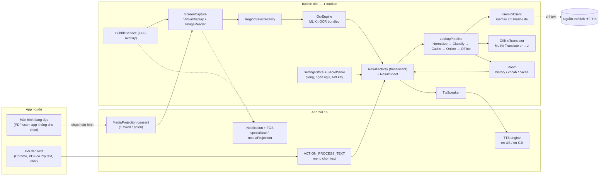
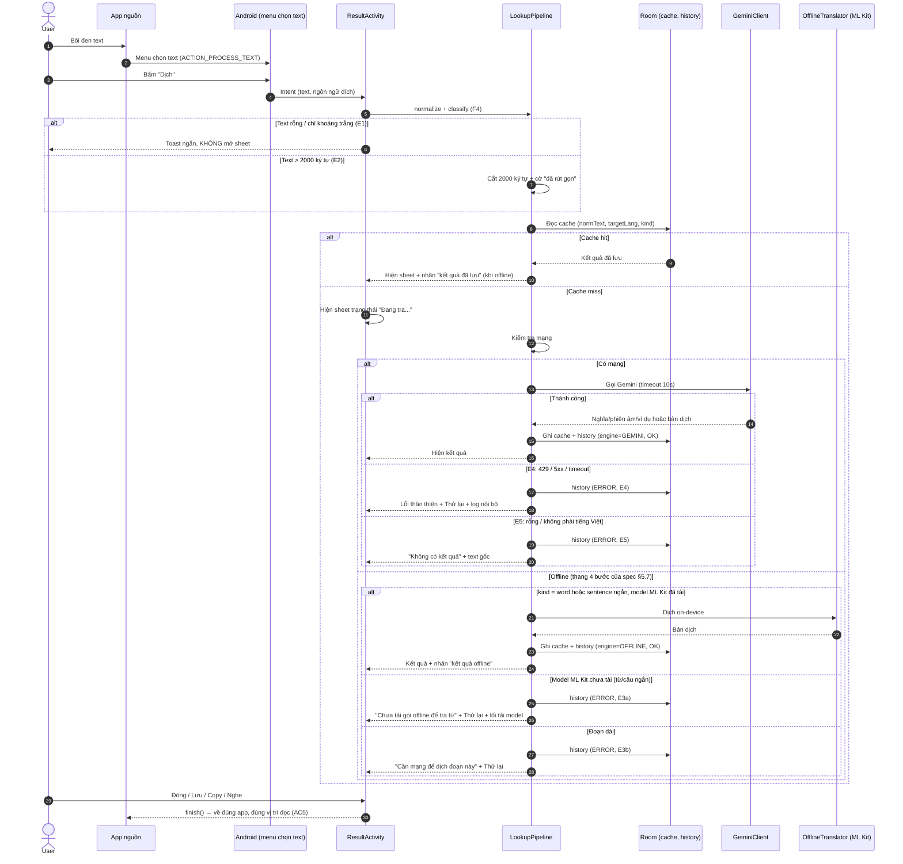
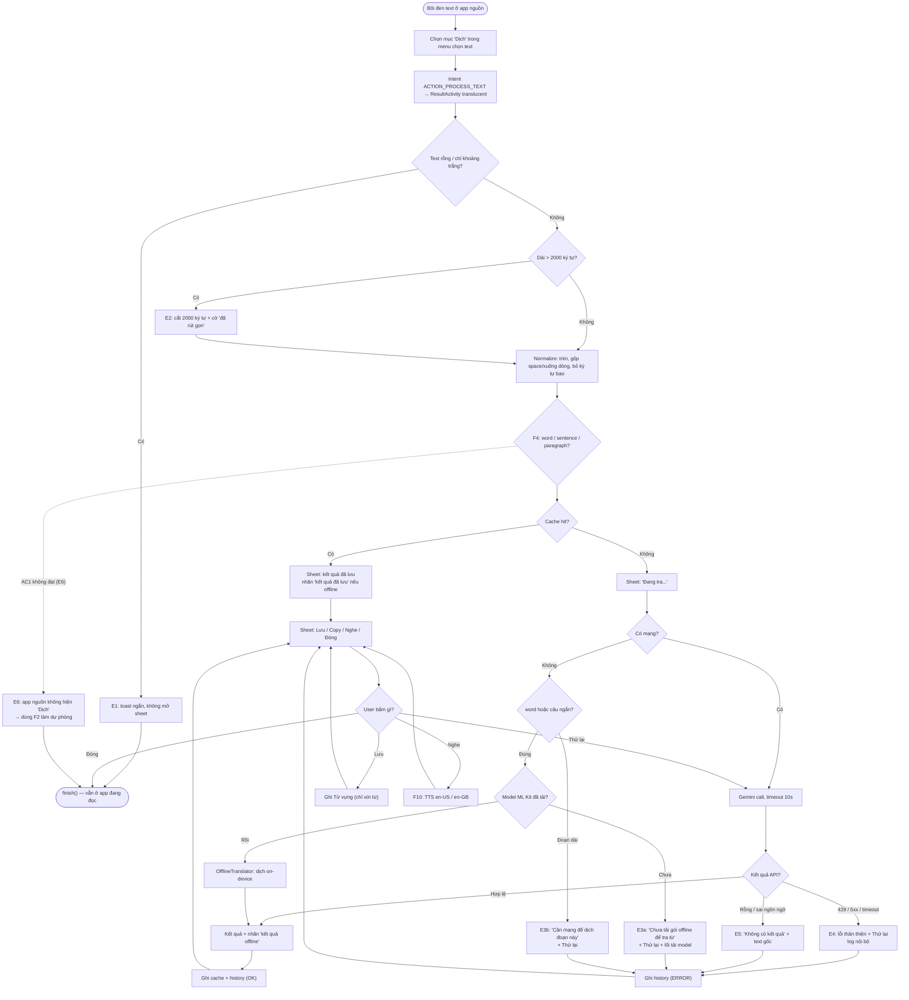
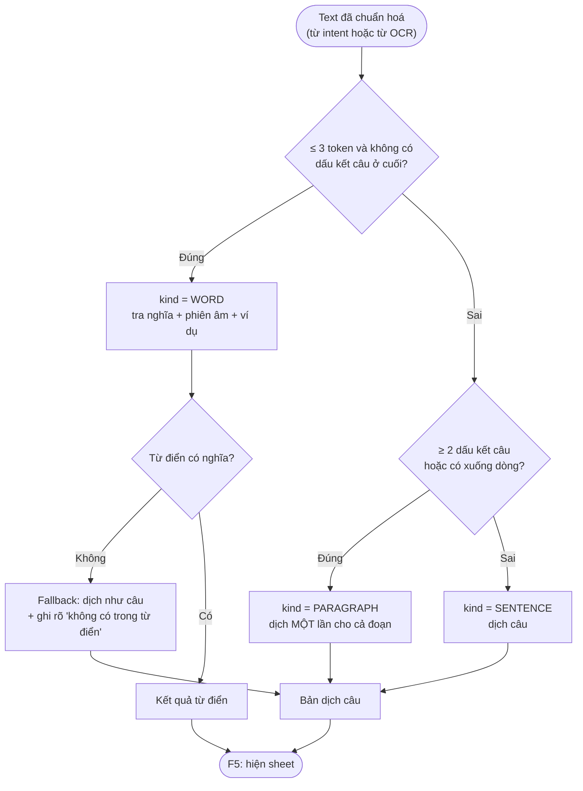
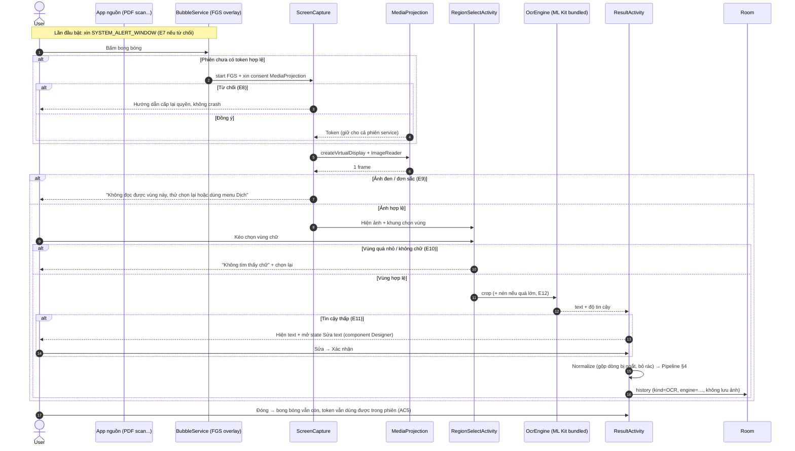
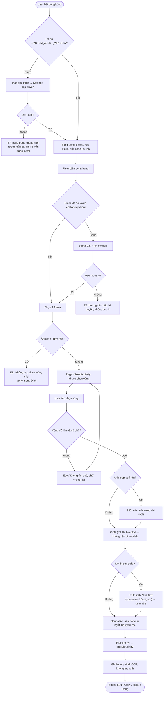
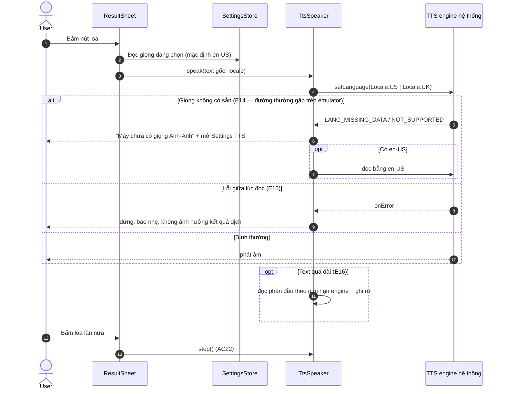
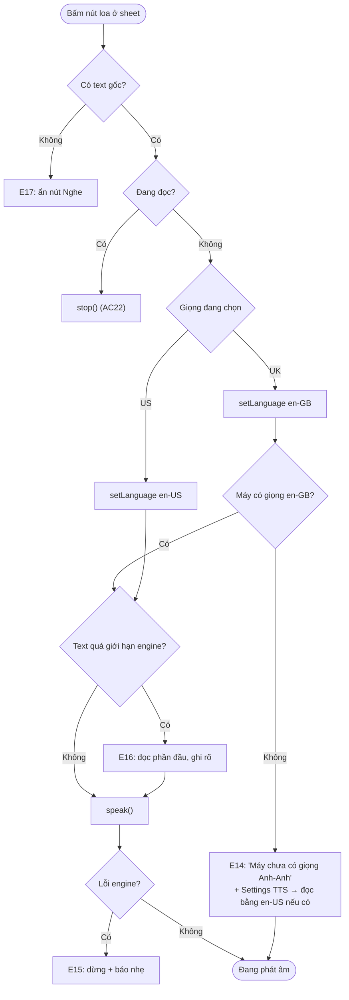
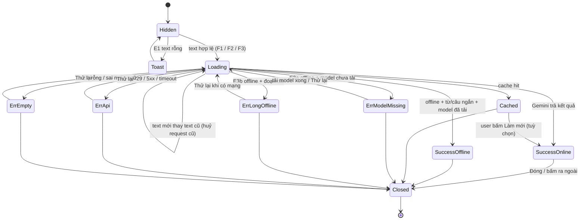
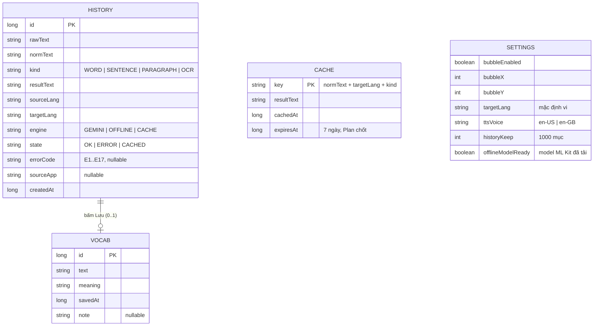

# Luồng MVP — bubble-dict

- Phiên bản: 1.1 — 2026-11-04. Nguồn: [spec MVP v1.2](../specs/mvp-spec.md) + [plan v1](../plans/mvp-plan.md) (§2–§3).
- Thay đổi so với 1.0: bỏ mâu thuẫn C1 (offline còn thang 4 bước), chốt **1 token MediaProjection / phiên**, E11 dùng component sửa text của Designer, F1 là **Activity translucent** (không phải overlay), ma trận lỗi cập nhật theo AC1–AC23.
- Người vẽ: Flow. Người đọc: Planner, Designer, FE, BE, QA.
- Định dạng: Mermaid; cần bản vẽ tay thì xuất thêm `.excalidraw` cùng thư mục.

**Mục đích (1 câu):** chốt đường đi chính xác của text từ lúc user bôi đen/OCR tới lúc thấy kết quả hoặc lỗi, để FE/BE code đúng nhánh và QA test đủ nhánh.

**Tác nhân:** User; App nguồn (Chrome, PDF reader, chat); Android framework (menu chọn text, MediaProjection, Notification/FGS, TTS engine); App bubble-dict (ResultActivity, BubbleService, ScreenCapture, RegionSelectActivity, OcrEngine, LookupPipeline, GeminiClient, OfflineTranslator, Room, SettingsStore/SecretStore, TtsSpeaker); Nguồn tra/dịch qua HTTPS.

**Điều kiện bắt đầu:** app đã cài; đúng quyền của từng luồng đã cấp (§2). F1 **không** cần quyền runtime nào ngoài Internet.

**Kết thúc — thành công:** user thấy kết quả trong sheet, đóng lại thì quay về đúng app nguồn và đúng vị trí đọc; lượt tra đã ghi lịch sử và cache.

**Kết thúc — lỗi:** sheet hiện thông điệp tiếng Việt + một đường lui (Thử lại / dùng F1 / chọn lại vùng), lượt tra ghi lịch sử trạng thái lỗi, app không crash.

---

## 1. Kiến trúc luồng (bám plan §3)

Khác biệt quan trọng so với bản 1.0: **F1 dùng Activity translucent chứ không dùng overlay window**. Hệ quả là F1 không cần `SYSTEM_ALERT_WINDOW`, nên AC1/AC23 và E7 tự thoả. Ảnh chụp màn hình **không** rời máy; chỉ text đã chuẩn hoá mới lên mạng.

---

## 2. Quyền theo từng luồng

| Luồng | Quyền / cơ chế | Xin lúc nào | Từ chối thì nhánh nào | AC |
|---|---|---|---|---|
| F1 menu "Dịch" | Không quyền runtime (khai báo `ACTION_PROCESS_TEXT`) + Internet | Cài app là có | E6: app nguồn không hiện "Dịch" → dùng F2 | AC1, AC6, AC23 |
| F2 bong bóng | `SYSTEM_ALERT_WINDOW` | Lần đầu bật bong bóng, có màn giải thích | E7: không có bong bóng; F1 vẫn chạy | AC7, AC23 |
| F2/F3 chụp | MediaProjection consent | Bấm bong bóng **lần đầu trong phiên**; giữ token tới khi service chết | E8: không chụp, hiện hướng dẫn | AC8, AC9 |
| F2/F3 chạy nền | FGS type `specialUse` + `mediaProjection`, `POST_NOTIFICATIONS` (13+) | Lần đầu dùng bong bóng, trước khi lấy token | Hệ thống không cho FGS → không chụp, báo nhẹ | AC23 |
| F1/F2/F3 tra/dịch | Internet (`INTERNET`, manifest) | Không xin runtime | E3: thang offline; vẫn xem lịch sử/cache | AC14–AC17 |
| F10 phát âm | Không quyền (TTS hệ thống); thiếu giọng → mở Settings TTS | Không xin | E14: báo thiếu giọng, không im lặng | AC21 |

Thứ tự bắt buộc cho FE: **start FGS → xin/tạo token MediaProjection → đăng ký Callback → `createVirtualDisplay`**. Android 14+ token dùng một lần, nhưng **giữ token cho cả phiên service**: bấm bong bóng lần 2 trong cùng phiên **không** xin consent lại; chỉ xin lại khi service bị hệ thống kill hoặc user tắt/mở bong bóng (Chief chốt).

---

## 3. F1 — Menu chọn text → tra từ/dịch

### 3.1 Sequence

### 3.2 Flowchart (kèm E1–E6 + thang offline)

Ghi chú: nhánh offline đã khớp thang 4 bước của spec v1.2 §5.7 (cache → API → ML Kit cho từ/câu ngắn → E3 cho đoạn dài hoặc thiếu model). Mâu thuẫn C1 của bản 1.0 đã hết.

---

## 4. Pipeline chung (dùng lại cho F1, F2, F3)

Ràng buộc QA kiểm được: đoạn ≥ 2 câu phải giữ đủ số câu (AC4) và TTS đọc cả đoạn (AC20). Kết quả offline (ML Kit) **không có phiên âm/ví dụ** → F5 phải ẩn phần đó thay vì hiện rỗng.

---

## 5. F2/F3 — Bong bóng nổi + OCR

### 5.1 Sequence

### 5.2 Flowchart (kèm E7–E13)

Lưu ý: E13 (model OCR chưa tải) **không còn là đường thường gặp ở MVP** vì plan chọn ML Kit OCR **bundled** trong APK. Giữ nhánh E13 trong test matrix chỉ để kiểm trường hợp lỗi khởi tạo OCR (thiếu dữ liệu, hết dung lượng) — QA vẫn phải có case theo yêu cầu phủ đủ E1–E17.

---

## 6. F10 — Phát âm Anh-Anh / Anh-Mỹ

F10 không gọi API, không phụ thuộc mạng; đổi giọng **không** đổi kết quả dịch và **không** ghi lịch sử mới.

---

## 7. State machine — ResultActivity / ResultSheet

Nhánh OCR (trước khi vào `Loading`): `OcrDone → EditText (E11) → Loading`. `EditText` là **state trong sheet**, dùng component sửa text của Designer — không phải màn mới.
Trạng thái `Success*` có nhánh phụ **Nghe** (§6), không đổi state chính.
Ràng buộc: `Loading → Loading` chỉ khi text khác text đang chờ; cấm hiện kết quả lệch text (spec §5.1).

---

## 8. Dữ liệu (ERD) — bám plan §4

Tách `HISTORY` khỏi `VOCAB` để xoá lịch sử không mất từ đã lưu (AC12). `CACHE` tách khỏi `HISTORY` để đổi TTL không ảnh hưởng lịch sử. Key API **không** nằm trong 4 bảng trên: ở `SecretStore` (`EncryptedSharedPreferences`), `allowBackup=false`, cấm log.

---

## 9. Ma trận lỗi E1–E17 → hiển thị → AC

| ID | Luồng | Điều kiện | Hiển thị | AC spec v1.2 | Ghi chú |
|---|---|---|---|---|---|
| E1 | F1 | text rỗng/khoảng trắng | toast, không mở sheet | AC6 | |
| E2 | F1 | > 2000 ký tự | dịch phần đầu + "đã rút gọn" | **không có AC** | QA phủ qua test plan |
| E3a | F1/F2 | offline, model chưa tải, từ/câu ngắn | "Chưa tải gói offline để tra từ" + Thử lại + lối tải model | AC15 | |
| E3b | F1/F2 | offline, đoạn dài | "Cần mạng để dịch đoạn này" + Thử lại | AC16 | |
| E4 | F1/F2 | 429/5xx/timeout > 10s | lỗi thân thiện + Thử lại, log nội bộ | **không có AC** | |
| E5 | F1/F2 | rỗng / không phải tiếng Việt | "Không có kết quả" + text gốc | **không có AC** | |
| E6 | F1 | app nguồn không hiện "Dịch" | không hiển thị → dùng F2 | AC1 (gián tiếp) | QA lập danh sách app |
| E7 | F2 | từ chối overlay | hướng dẫn bật lại; F1 vẫn chạy | AC7, AC23 | |
| E8 | F2 | từ chối MediaProjection | hướng dẫn, không crash | AC9 | |
| E9 | F2/F3 | app nguồn chặn chụp → ảnh đen | "Không đọc được vùng này" | AC10 | |
| E10 | F2/F3 | vùng quá nhỏ / không chữ | "Không tìm thấy chữ" + chọn lại | **không có AC** | AC8 chỉ phủ happy path |
| E11 | F2/F3 | OCR tin cậy thấp | state Sửa text, dịch sau khi user xác nhận | **không có AC** | dùng component Designer |
| E12 | F3 | ảnh crop quá lớn | nén; vẫn lỗi thì báo | **không có AC** | |
| E13 | F3 | lỗi khởi tạo OCR (model bundled) | báo lỗi + gợi ý thử lại | **không có AC** | hiếm vì OCR bundled |
| E14 | F10 | thiếu giọng en-GB | "Máy chưa có giọng Anh-Anh" + Settings TTS | AC21 | đường thường gặp trên emulator |
| E15 | F10 | TTS lỗi giữa lúc đọc | dừng, báo nhẹ | **không có AC** | |
| E16 | F10 | text quá dài cho TTS | đọc phần đầu, ghi rõ | AC20 (một phần) | AC20 chỉ kiểm đoạn 3 câu |
| E17 | F10 | không có text gốc | ẩn nút Nghe | **không có AC** | |

Trạng thái thành công: AC2 (từ ≤ 3s), AC3 (câu), AC4 (đoạn 3 câu), AC14 (offline từ), AC17 (cache offline). Tester đã được giao phủ đủ E1–E17 nên 10 nhánh "không có AC" sẽ có case trong `docs/qa/mvp-test-plan.md` — không cần chờ Spec thêm AC.

---

## 10. Mâu thuẫn & nhánh thiếu

**Đã chốt xong (bản 1.0 → 1.1):**
- C1 (offline ML Kit vs spec) → spec v1.2 §5.7 thang 4 bước; từ/câu ngắn offline, đoạn dài báo cần mạng. Hết lệch.
- E11 (thiếu ô sửa text) → Designer có component "sửa text OCR"; dùng làm state trong sheet.
- C5 (MediaProjection lần bấm thứ 2) → giữ 1 token/phiên service; chỉ xin lại khi service bị kill.

**Còn mở — cần Plan/Spec chốt (nhỏ, không chặn FE/BE code ngay):**
- **O1. "Câu ngắn" chưa có ngưỡng số.** Spec §5.7 bước 3 và E3 chỉ nói "từ/câu ngắn". `LookupPipeline` cần một con số để quyết định gọi ML Kit offline hay báo E3b. Đề xuất: `kind = WORD`, hoặc `SENTENCE` với ≤ 200 ký tự và 1 câu. Plan chốt rồi ghi vào `LookupPipeline` + test plan.
- **O2. Kết quả offline thiếu phiên âm/ví dụ.** ML Kit chỉ dịch, không có nghĩa từ điển. F5/Designer cần quy định: với `engine=OFFLINE` thì ẩn hàng phiên âm/ví dụ, không hiện placeholder rỗng (AC14 chỉ yêu cầu nghĩa + nhãn).
- **O3. `kind` lệch giữa plan và spec.** Spec §7 có `paragraph`; plan §4 chỉ có `WORD / SENTENCE / OCR`. FE/BE cần một nguồn sự thật: thêm `PARAGRAPH` vào enum (đề xuất) hoặc quy ước paragraph ≙ SENTENCE.
- **O4. Trạng thái `CACHED` trong plan §4 nhưng không có trong luồng.** Plan đặt `state = OK | ERROR | CACHED`; luồng của tôi dùng `engine = CACHE` + nhãn "kết quả đã lưu". Cần chốt chỉ dùng `engine`, hay giữ cả hai (dễ sinh dữ liệu lệch).
- **O5. Traceability của plan đang theo AC cũ.** Plan §7.6 (QA-01 "AC1–AC15"), §7.5 (FLOW-01 "E1–E13") và bảng §8 (AC→task chỉ tới AC15) viết trước spec v1.2, khi AC chỉ tới 21 và E chỉ tới 17. Planner cần cập nhật để QA/CR không test thiếu AC16–AC23.

---

## 11. Đã kiểm chứng / chưa kiểm chứng

- **Đã kiểm chứng:** 10 sơ đồ của bản 1.0 parse + render SVG thành công bằng Mermaid 11 trên Chromium headless; bản 1.1 được kiểm lại cùng cách. Đây là kiểm tra cú pháp/render, không phải kiểm tra nghiệp vụ.
- **Chưa kiểm chứng:** toàn bộ hành vi Android — chưa build, chưa chạy app, chưa lên emulator.
- Hai test sớm nhất có thể đổi kiến trúc: `ACTION_PROCESS_TEXT` có hiện trong Chrome/PDF reader Android 15 (P2, BE-11); MediaProjection + overlay chạy cùng lúc (P4, BE-14/16). Kết quả sai thì báo Chief để đổi hướng.
- Còn phải xác nhận khi chạy: emulator có voice pack `en-GB` (AC21 — dự kiến **fail**, là đường thường gặp); ML Kit Translate tải model được trên emulator `google_apis` (R2 của plan); giới hạn độ dài text của TTS engine (E16).